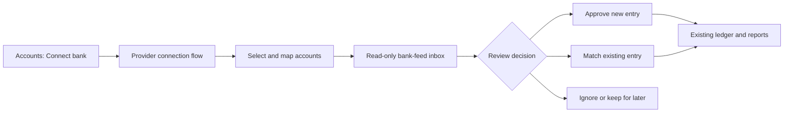

# RBC and TD bank-sync implementation plan

Status: implementation started; the user selected **build the demo first**. The local simulator is implemented. Plaid Sandbox and production remain pending. No live connection, paid service or production migration has been performed.

## Current delivery: isolated demo

- Run `npm run dev:preview`, sign in to the local demo, then open **Accounts → Try bank demo**, or `/bank-demo`.
- The simulator stores sample feeds, decisions and a separate CAD ledger in `.pglite-bank-demo/`. It does not use the application ledger tables. There is no migration of the main application database.
- Access requires a local development process, explicit `BANK_SYNC_MODE=demo`, an embedded preview database, no `DATABASE_URL`, no Vercel environment, and an owner session. Production builds return 404 for the demo.
- Includes RBC/TD synthetic connection setup, account mapping, cutoff date, manual sync, matching existing manual/scheduled entries, reviewed imports, atomic bulk imports, transfer pairing, pending-to-posted replacement, ignored entries, correction review, reconnect/disconnect and a decision log.
- All monetary values use integer cents. Commands use a compare-and-swap version on the isolated database so stale tabs and simultaneous approvals cannot double-import.
- This is a deterministic simulator, not Plaid Sandbox. It is not evidence of RBC/TD coverage, provider security, background delivery, or production database concurrency. It does not use Plaid credentials or make bank/network calls.
- Design adjustment for the demo milestone: production bank schema, token storage, queue/webhook processing and backups of bank credentials are deferred until the Sandbox phase. The existing encrypted production backup job and its schema coverage remain unchanged.
- See [BANK-DEMO.md](BANK-DEMO.md) for the walkthrough, checks and remaining work. Production milestones below are still release gates, not completed features.

Prepared: 13 October 2026, America/Toronto. Target: the existing Expense Tracker web application. Provider and pricing facts must be checked again before activation.

## 1. Outcome and recommendation

Connect selected Canadian RBC and TD accounts, retrieve their transactions, and let the user review, match or approve them into the existing ledger. Approved entries then participate in the existing dashboard, account activity, budgets and reports.

The strongest case against immediate automatic importing is accounting correctness: manual entries, scheduled bills, pending payments and both sides of transfers can represent the same movement more than once. A working bank login is not proof that balances are correct. Start with a separate review inbox and no automatic posting.

The first deliverable is an end-to-end local simulator. The first external milestone is Plaid Sandbox. The first live milestone is one explicitly selected account in observation-only mode, where bank data cannot write financial ledger entries.

## 2. Current repository baseline

Verified against the repository during preparation:

| Existing area | Integration consequence |
| --- | --- |
| Next.js 16.2.7, React 19, TypeScript, Drizzle | Read installed Next.js documentation before implementing route handlers and mutations; pin compatible provider SDK versions. |
| `src/lib/db/index.ts`: Neon HTTP in production, PGlite locally | Atomic operations must work with the actual Neon driver; do not assume interactive transactions are supported. |
| `src/lib/db/schema.ts`: workspace-scoped accounts, transactions, transfers, recurring rules | Add separate bank tables and import links; preserve existing financial rows and IDs. |
| `src/lib/actions.ts`, `workspace-references.ts` | Reuse permission/reference validation, but add an atomic approval operation rather than calling several independent actions. |
| `src/lib/import-action.ts` | Current CSV/Excel importer is an immediate import path, not a bank-feed reconciliation engine. Do not reuse it for automatic bank ingestion. |
| `src/lib/queries.ts`, `src/app/api/cron/recurring/route.ts` | Recurring rules can create transactions independently of bank sync. Match against these too. |
| `src/proxy.ts` | Cookie gating needs narrow exceptions for provider webhooks and queue callbacks, each with its own verification. |
| `src/components/accounts-section.tsx`, `account-detail-view.tsx`, paged Activity | Add bank badges, connection controls, source indicators and review entry points without replacing existing manual flows. |
| `src/lib/transaction-edit.ts`, `transaction_history` | Preserve user edits; add an import decision audit rather than pretending old edits can be reconstructed. |
| `scripts/backup-db.ts`, `BACKUP-RECOVERY.md` | Backup table lists, restore rehearsal, exports and secret-key recovery need updates before live ingestion. |
| `vercel.json`: one daily recurring cron | A daily cron alone is not prompt webhook processing. Use durable dispatch and retain a recovery sweep. |

## 3. Scope and firm defaults

**Version 1 includes:** Canadian personal chequing/savings and credit-card accounts supported by the provider; CAD approval; explicit mapping; a paginated inbox; category suggestions; matching to existing entries; posted-transaction approval; transfer review; reconnection; disconnection; auditable decisions; visible sync health.

**Deferred:** payments or money movement, investments, loans, automatic posting, foreign-exchange accounting, native Expo Link screens, AI categorization, paid recurring-transaction detection, and broad support for other providers. Native screens can later reuse the authenticated backend with platform-specific Link setup.

**Safety invariants:**

1. Sync writes bank-feed tables only. Only an authorized approval/correction action may write ledger tables.
2. Matching an existing transaction creates a link, not a second transaction.
3. Pending, ignored, unselected and pre-cutoff feed entries never affect confirmed totals.
4. A provider correction or removal never silently changes/deletes an approved ledger entry.
5. Bank-reported balances never overwrite opening balances or calculated balances.
6. Disconnecting does not delete existing ledger entries or import history.
7. No real account numbers, tokens, passwords or transaction descriptions in logs, fixtures or screenshots used for public evidence.
8. No reset, truncate, destructive schema push or automatic restore over live data.

## 4. Experience and screens

### Connection setup

- Explain which institution/accounts are being shared and that the workspace owner and permitted members will see approved ledger data.
- Only the workspace owner can create live connections in v1. Never infer permission to connect another person's bank account.
- Use provider-hosted Link and bank authorization where supported; never build an app-owned banking password form. Confirm the actual authorization method for each bank during the pilot.
- Show selected account name, type, masked suffix and currency. Do not infer account identity from a display name or last four digits alone.
- Map to one existing, active tracker account or explicitly create a new one. Enforce one active mapping per bank account and tracker account initially.
- Owner confirms the ledger's currency is CAD; the current display currency setting is insufficient evidence of historical currency.
- Default the approval cutoff to the connection date. Explain that downloaded history may begin earlier; older entries require a separate explicit review. No automatic opening-balance adjustment.
- Keep mapping locked after import decisions. Any remap requires a dedicated review of existing links rather than silently moving history.

### Bank-feed inbox

- Tabs: Needs review, Pending, Linked/Imported, Ignored, Changes to review.
- Filters: connection/account, date, merchant, state and suggested category; server-side pagination and totals scoped to the same filters.
- Each row shows posted/authorized date where available, description, amount/direction, currency, category suggestion and duplicate reason.
- Actions: Match existing, Approve new, Mark as transfer, Ignore. User can reverse Ignore into Needs review.
- Show a confirmation summary before bulk approval. Process rows idempotently and report individual outcomes; never claim a partly failed batch fully succeeded.
- No bulk approval for ambiguous transfers, refunds, foreign currency, pending entries or unresolved bank corrections.

### Connected account and settings

- Status: Connected, Syncing, Reconnect needed, Paused, Disconnecting, Disconnected, Error.
- Distinguish last successful bank update from last app sync and last attempted sync.
- Show bank current/available balances with source timestamps separately from ledger balance; do not imply identical coverage or timing.
- “Check for updates” retrieves provider-available data. A forced institution refresh is separate and disabled until its cost and availability are approved.
- Preserve compact desktop layout, mobile touch targets, keyboard access, clear labels and the established ledger styling.

## 5. Architecture and environments

Use a small server-only `BankProvider` interface with `demo` and `plaid` adapters. Keep matching, approval and ledger logic provider-independent without building a general integration marketplace.

| Mode | Data and credentials | Execution |
| --- | --- | --- |
| `demo` | Deterministic synthetic records; no Plaid credentials | Isolated PGlite preview and a local job runner; no network bank calls |
| `sandbox` | Plaid Sandbox keys; isolated database and webhook URL | Real Link/API contract tests with fake bank data |
| `production` | Explicitly enabled production provider, production keys, workspace allowlist | One-account pilot before broader access |

Proposed server-only configuration: `BANK_SYNC_ENABLED`, `BANK_SYNC_MODE`, `BANK_SYNC_ALLOWED_WORKSPACES`, `PLAID_CLIENT_ID`, `PLAID_SECRET`, `PLAID_REDIRECT_URI`, `PLAID_WEBHOOK_URL`, `BANK_TOKEN_KEY_ID`, `BANK_TOKEN_KEY`, plus the existing cron authentication. Separate Sandbox and Production credentials. No secret gets a `NEXT_PUBLIC_` prefix.

Default disabled. Reject inconsistent mode/key/host combinations. Preview scripts must force demo mode and clear production bank credentials, just as they currently disable the external database. Demo endpoints must be absent or inaccessible in production, not merely hidden in the UI.

### Background execution decision

Proposed production transport: Vercel Queues with a database outbox/job record. Its documentation currently describes beta availability and at-least-once delivery [S5]. Confirm project support, limits, charges and beta suitability in Phase 0 before enabling it. The database owns correctness; queue delivery is only a wake-up mechanism.

Persist work before acknowledging a webhook. Dispatch after commit. If queue publishing fails, keep the pending outbox record for the recovery sweep. A dispatcher crash must not lose work. Duplicate deliveries must be safe. Do not rely on an unawaited promise, browser being open, or an in-memory queue.

Retain a bounded scheduled recovery sweep for undispatched jobs and expired leases. Verify cron limits before adding a second schedule; if using the current daily cron, isolate bank dispatch errors so recurring processing retains its existing behavior. The maximum recovery delay must be visible and documented. If queue access is unsuitable, replace the transport and prove equivalent delivery before the live pilot; do not silently ship fire-and-forget processing.

## 6. Proposed additive data model

All application-owned records carry workspace ownership. External IDs are opaque. Use explicit foreign keys, unique constraints, checks, decimal money values and UTC timestamps; preserve bank date-only fields separately.

| Table | Main fields and constraints |
| --- | --- |
| `bank_connections` | ID, workspace, connecting user, provider/environment, institution, external Item ID, encrypted token envelope and key version, status, consent metadata, committed cursor, sync timestamps/error code. Unique provider + environment + Item ID. |
| `bank_link_sessions` | User/workspace-bound short-lived setup or update session, mode, connection ID, completion/recovery status and expiry. Used to prevent cross-workspace exchange and recover uncertain completion. No plaintext long-lived tokens. |
| `bank_accounts` | Connection, external account ID, name/type/mask/currency, selection state, tracker account mapping, approval cutoff, observed balance/timestamp. Unique connection + external account ID; partial uniqueness for active mappings. |
| `bank_feed_transactions` | Connection/account, external transaction ID, pending predecessor ID, signed source amount, currency, dates, description, normalized category, bank state, review state, revision and first/last seen timestamps. Unique connection + external transaction ID. Store only required normalized data. |
| `bank_import_links` | Feed entry, optional ledger transaction or transfer, relationship/transfer side, imported vs matched provenance and approved revision. One link per feed entry; validate target type and workspace. Multiple feed versions/sides may deliberately reference one ledger movement. |
| `bank_review_events` | Actor, action, feed/link IDs, approved source revision, decision time and minimal before/after decision details. Distinct from existing transaction edit history. |
| `bank_sync_jobs` | Connection, reason, pending/running/retry/failed/done state, attempts, next attempt, lease owner/expiry, requested generation, error code and dispatch state. Coalesce work without losing events that arrive during an active sync. |
| `bank_sync_runs` and `bank_sync_updates` | Run ID, original/current/final cursors, completion state and staged normalized updates per page. Incomplete runs are not exposed as a completed feed update. |

Deletion rules must preserve ledger entries. Import links retain immutable original target IDs and decision history even when a nullable live ledger reference is cleared; never cascade-delete this provenance when a transaction is deleted. Existing account/transaction/workspace deletion and undo flows need explicit integration review: a deleted approved transaction must remain marked as previously handled, not reappear as a new import. Undo must either relink the replacement ledger entry atomically or leave an explicit repair state. Stop bank jobs before deleting a workspace; revoke provider access before discarding the only encrypted token.

Do not assign a migration number until implementation; choose the next available number then. Generated SQL must be reviewed for additions only. Avoid new indexes on large existing financial tables until query evidence warrants them.

## 7. Connection and synchronization behavior

### Connect and reconnect

1. Authenticate owner, resolve workspace on the server, check feature allowlist and rate limits.
2. Persist a setup session bound to user/workspace; create a Link token requesting only Transactions and the selected history window [S1].
3. On completion, exchange the temporary token server-side and verify the provider Item/accounts; never trust browser-supplied institution/account details as authority.
4. Encrypt the access token before storage; atomically persist the connection and setup outcome. If provider exchange succeeds but persistence fails, retry persistence without exchanging the used token again. Handle uncertain failures explicitly and attempt provider cleanup while the token is available; never silently accumulate orphan connections.
5. Owner confirms selected accounts, mapping and cutoff; queue initial sync.
6. Reconnect through Link update mode on the existing Item where supported [S4]. Avoid delete/recreate loops, which can consume Trial connection allocations and change external identities.

Use a per-Item stream/cursor in v1. Configure account selection to minimize shared data; do not stage unselected account transactions, and never expose them in the inbox. Validate provider account-selection behavior in Sandbox and the pilot. Requests for older history are a setup decision; the approval cutoff controls ledger eligibility independently.

### Durable sync

1. A verified webhook or authorized “Check for updates” request persists/coalesces a job. Webhook account ownership comes from the stored connection, not a supplied workspace ID.
2. Worker atomically claims a time-limited lease. One worker per connection; fence expired workers using a generation/lease token.
3. Fetch changes from the committed cursor and stage pages in a sync run. Renew or yield the lease before platform timeouts. Provider calls stay outside database transactions.
4. On pagination invalidation, discard/restart that incomplete run from its original cursor. Do not advance committed state from a partial page sequence [S1].
5. Once all pages are staged, atomically apply feed changes and advance the committed cursor with a compare-and-swap check. Never modify the ledger in this step.
6. Record success and acknowledge the queue message. If another update was requested during the run, schedule follow-up work instead of losing it when marking the job done.
7. Retry transient failures with capped exponential backoff/jitter and provider rate-limit handling. Authentication failures move to Reconnect needed; persistent failures remain visible and manually retryable.

Keep review state and user decisions separate from provider state. Replaying updates must not turn ignored/imported entries back into fresh transactions. A changed source revision invalidates stale approval requests and creates a correction review if already linked.

## 8. Accounting and approval rules

| Case | Required behavior |
| --- | --- |
| New posted CAD expense/income | Show category suggestion; approve atomically with ledger insert, link, audit event and feed decision. |
| Repeated click, request or webhook | Return the prior result or a safe conflict; never create another ledger row. |
| Possible manual duplicate | Suggest by mapped account, exact decimal amount, direction, date window and description. User confirms; no automatic merge from heuristics. |
| Recurring bill already posted | Include generated entries in matching. Introduce the same per-account database locking protocol in recurring materialization and bank approval, then recheck matches inside the atomic operation. A lock taken only by the importer is insufficient. If a matching scheduled occurrence is still due/unresolved, block approval until it is reconciled. Optional reminder-only mode requires a separate explicit change to the existing rule. |
| Pending becomes posted | Use the provider relationship where available; do not count both. Pending rows cannot be approved in v1. |
| Provider changes/removes an approved entry | Preserve the ledger; show old vs new data and require an audited correction or explicit dismissal. |
| Transfer between tracked accounts | Pair compatible sides into one existing/new transfer and link each feed side. Missing counterpart stays unresolved; do not approve as an expense by default. |
| Credit-card payment | Treat as transfer when both accounts are tracked. Validate liability direction and card-balance convention using fixtures. |
| Refund, reversal, fee or split payment | Require classification. Do not label every credit as income. V1 leaves unsupported refund/net-expense and split-allocation cases unresolved; add dedicated accounting support before claiming full coverage. |
| Foreign/unknown currency | Show source currency but block approval into the CAD ledger. Never relabel the numeric amount as CAD. |
| Bank balance differs | Explain bank timestamp, pending payments, cutoff and opening balance. Offer existing statement comparison; never silently force equality. |

Approve/match requires the expected feed revision, current workspace permission, current account mapping and a unique import link in one database operation. Existing user category/note/tag edits win over provider suggestions. Bank corrections to financial fields go through audited actions; never bypass transaction history.

Deleting an imported entry in the app is not the same as the bank removing it. Preserve handled-state provenance. Disconnecting retains the ledger and review history; “forget downloaded bank data” is a separate explicit action with a reviewed retention/deletion design.

## 9. Security, permissions and privacy

- Owner: connect, map, reconnect, disconnect and approve imported data. Members: see approved ledger entries as today; raw inbox access and import approval are owner-only in v1. Viewers: no mutations. UI hiding is never the authorization check.
- Revalidate ownership on every endpoint and job. A session workspace switch cannot apply an old review selection to another workspace.
- AES-256-GCM token encryption with a random nonce, authenticated connection/workspace/environment context and versioned keys. Keys live in server secret storage, outside the database and Git. Document rotation and independent recovery.
- Webhooks: verify the JWT signature/key, permitted algorithm, issuance freshness and raw-body digest using the official procedure [S2]. Limit body size; cache verification keys safely; unknown/revoked Items must not create records.
- Narrow proxy exceptions only for the exact webhook/queue routes. Queue callbacks use provider verification; recovery cron uses the existing secret. Browser mutations use session, origin/CSRF protections and rate limits.
- Logs contain run IDs, counts, durations and sanitized codes; no tokens, full bank payloads, merchant descriptions or credentials. Public errors do not expose provider response bodies.
- Disconnect first pauses local work, then revokes the provider Item, then destroys active credentials after confirmed revocation. Keep an encrypted retryable revocation record if the provider is unavailable; show Disconnecting, not a false success.
- A database restore defaults bank syncing OFF. Old backups may contain revoked credentials: never automatically reactivate them. Verify current consent/connection status or reconnect before enabling jobs.
- Minimize retained fields. Proposed staged-run retention: seven days after successful application; proposed sanitized job-log retention: 30 days. Approval/link audit persists with the ledger. Confirm these policies before live activation and explain retained encrypted backups separately.

## 10. API and code work map

Names below are proposed, not existing endpoints.

| Area | Planned files/routes |
| --- | --- |
| Provider interface and adapters | `src/lib/bank/provider.ts`, `demo-provider.ts`, `plaid-provider.ts`, `config.ts`, `token-crypto.ts` |
| Domain operations | `src/lib/bank/sync.ts`, `jobs.ts`, `normalize.ts`, `matching.ts`, `approval.ts`, `permissions.ts` |
| Connection management | `POST /api/bank/link-token`, `POST /api/bank/exchange`, `POST /api/bank/connections/[id]/reconnect`, `/disconnect`, `/sync` |
| Mapping and review | `PATCH /api/bank/accounts/[id]`, `GET /api/bank/feed`, `POST /api/bank/feed/[id]/decision`, `POST /api/bank/review-batch` |
| Status | `GET /api/bank/connections`, sanitized job/connection status responses |
| Background entry points | `POST /api/webhooks/plaid`, verified queue callback route, protected outbox recovery sweep |
| UI | `src/components/bank/connect-bank.tsx`, `bank-connections.tsx`, `account-mapping.tsx`, `bank-feed.tsx`, `review-transaction.tsx`, `sync-status.tsx` |
| Integration points | Schema/migrations, accounts/dashboard navigation, Activity provenance, existing delete/undo flows, CSV-import interaction, backup/export scripts, preview isolation, deployment config |

All endpoints validate bounded inputs and return consistent statuses: unauthorized/forbidden, invalid input, stale revision/conflict and temporary service failure. Raw access tokens never appear in a response.

## 11. Delivery phases and acceptance gates

### Phase 0 — provider and operating decisions

- [ ] Verify RBC/TD institution IDs, account types, Transactions support and authorization method in the current provider dashboard/API. Public bank-name listings alone are insufficient.
- [ ] Confirm Trial eligibility, connection-creation allowance and restrictions; capture actual offered paid rates without enabling billing. Trial is not a promise of indefinite free access [S3].
- [ ] Approve history request length, account-sharing scope, CAD limitation and owner-only review policy.
- [ ] Confirm queue access/beta suitability, callback authentication, function limits, recovery scheduling and cost budget.
- [ ] Define secret recovery, disconnect and retention procedures.

**Exit:** recorded decisions and provider access path. Missing production access must not block independent simulator work, but blocks real-account activation.

### Phase 1 — isolated foundation and simulator

- [ ] Add disabled-by-default configuration and provider interface.
- [ ] Create/review additive schema, migrations, constraints and local fixtures.
- [ ] Build deterministic demo accounts, balances, paging, pending-to-posted transitions, corrections, removals, errors and reconnect simulations.
- [ ] Implement local durable job runner and atomic approve/match operations.
- [ ] Update backup/restore table coverage before claiming schema readiness.

**Exit:** repeatable local scenario proves that 100 identical approval attempts create exactly one ledger entry and that pure sync changes zero existing financial rows.

### Phase 2 — complete review experience

- [ ] Accounts entry point, mapping wizard, inbox and source/status badges.
- [ ] Duplicate suggestions, transfer pairing, ignore/review, revision conflicts and bulk-result reporting.
- [ ] Explicit handling for scheduled bills, deleted/undone entries and unsupported accounting cases.
- [ ] Compact desktop/mobile views, accessible controls, loading/empty/retry states.

**Exit:** a user can complete connect → map → sync → match/approve → see correct dashboard totals entirely in demo mode.

### Phase 3 — Plaid Sandbox and durable delivery

- [ ] Integrate Link, exchange, update mode, account selection, normalization and cursor sync.
- [ ] Add webhook signature verification, outbox dispatch, queue worker, leases, retry/backoff and recovery sweep.
- [ ] Exercise OAuth return state, user cancellation, provider outage, expired consent and disconnect failure.
- [ ] Verify no new provider connection is created by ordinary reconnection.

**Exit:** fake-provider contract tests and actual Sandbox tests pass; interrupted multi-page sync resumes safely and no stale worker can overwrite a newer cursor.

### Phase 4 — release safety and observation-only pilot

- [ ] Finish tests, lint, typecheck, isolated production build and browser evidence.
- [ ] Fresh encrypted production snapshot; successful isolated restore; record financial-row/balance baseline.
- [ ] Apply reviewed additive migration with feature disabled; verify old financial rows unchanged and rehearsal with the new schema succeeds.
- [ ] Deploy feature-disabled code under Jimish Gajjar's configured Git identity; verify exact commit on the live domain.
- [ ] User connects ONE selected account through the intended provider flow. Initially keep ledger approval disabled in production.
- [ ] Observe initial history plus at least one later update; compare representative posted transactions and bank timestamps with the user's statement. Do not equate Sandbox success with RBC/TD live acceptance.

**Exit:** no financial ledger writes from connection/sync; selected account/currency correct; bank-feed coverage and duplicates understood; production backup includes all new tables.

### Phase 5 — reviewed posting and second bank

- [ ] Enable approval for the pilot owner only; review and approve a small identified batch or match existing entries.
- [ ] Verify each ledger change against its authorized decision and reconcile totals. After posting, expect approved additions; do not use an unchanged-row-count claim as the only correctness test.
- [ ] Test provider reconnect/disconnect without deleting ledger data.
- [ ] Add the second bank only after the first has passed these checks.
- [ ] Deliver operating runbook, status/usage view and bank-specific known limitations.

**Exit:** both selected banks have documented live results, not merely nominal coverage. Future automatic posting requires a separate design and approval.

## 12. Required automated and manual test matrix

| Scenario | Expected result |
| --- | --- |
| Other workspace IDs, foreign accounts, viewer/member mutation | Denied; no writes or raw-feed disclosure |
| Wrong environment or missing token key | Fail closed; existing tracker continues working |
| Forged/stale webhook or wrong body digest | Rejected; no jobs created |
| Duplicate/out-of-order webhooks | Coalesced or safely replayed; no missing updates |
| Crash after staging / before cursor commit | No partial committed feed; recover from stored run/original cursor |
| Crash after commit / before queue acknowledgement | Replay harmless |
| Lease expiry and concurrent workers | Stale worker cannot commit |
| Pagination invalidation and connection timeout | Correct restart/retry; no cursor skip |
| Concurrent approvals and stale revision | One ledger movement or explicit conflict |
| Two genuine same-day same-amount purchases | Remain separate unless user explicitly matches |
| Pending amount/date changes | No duplicate confirmed movement |
| Removed/modified previously imported entry | Correction review; existing user data preserved |
| Recurring cron races with bank approval | Recheck or conflict; no silent double count |
| Transfer sides, credit-card repayment, missing counterpart | Correct single transfer or unresolved review |
| Refund, FX, unknown currency | Explicit unsupported/review state; no false income/CAD values |
| Delete/undo imported entry | Preserved provenance and deliberate relink/repair |
| Reconnect with changed external account identity | Reconfirm mapping; no name/mask-only auto-merge |
| Disconnect/provider outage/workspace deletion | Local jobs stop, revocation retries retained, ledger preserved |
| Encryption wrong key/tampering/rotation | Reject invalid ciphertext; verified rotation retains access |
| Restored backup containing old tokens | Sync stays disabled until consent/status validation |
| Keyboard, screen reader, 390px layout, slow/offline network | All decisions usable; no misleading saved/connected status |

Use Vitest/PGlite for domain tests and disposable PostgreSQL/Neon test data for production-driver concurrency and atomicity. Never use live transactions as test fixtures. Signed-in end-to-end tests must initially target the isolated demo/Sandbox workspace.

Proposed commands to add: `npm run test:bank`, `npm run bank:demo`, `npm run bank:worker:local`. They do not exist yet. Existing gates: `npm test`, `npm run lint`, `npm run typecheck`, `npm run build:preview`.

## 13. Release, recovery and operations

Release small, independently reviewable changes by phase. Keep the core ledger compatible with feature-disabled code. Expand `scripts/backup-db.ts` restore ordering and comparison coverage for bank tables, extend exports with safe provenance/review data, and exclude credentials from Excel exports.

Before each live schema change: fresh verified backup, reviewed SQL, migration lock/timeout, financial-data baseline and restore rehearsal. Prefer isolated copies for rehearsal; never reseed/reset production. After migration and before approvals, compare all existing financial rows and balances. Additions to bank tables are expected.

Emergency disable stops new connections, sync and approval but keeps the normal app usable. Disconnect/revocation remains operable while the feature is disabled. Roll back application code without dropping new tables or restoring an old database. Fix disputed imports individually using their audit links; never erase all activity after a timestamp.

Monitor job age, success/failure counts, retry exhaustion, reconnect count, unmatched corrections, import conflicts, outbox dispatch failure, provider usage and backup age. In-app warnings are required; external notifications need a configured, approved destination. No private transaction details in alerts.

Daily backups remain dependent on this computer being available and its Windows user signed in. Bank sync must run server-side and must not depend on that computer. Loss of the backup machine/profile and token keys is a separate recovery risk addressed in the existing recovery guide.

## 14. Cost and activation checklist

- Plaid Sandbox: free provider testing. New eligible Trial teams may use a limited number of real connections; confirm current conditions in the actual account [S3].
- Paid Transactions, optional refreshes, queue operations, Vercel execution and Neon storage are separate cost lines. Record currency, included usage, taxes and applicable limits before accepting a paid plan.
- Request Transactions only for v1; no paid enrichment, forced refresh or recurring detection add-ons by default.
- Set a live-connection cap and rate limits before launch. Repeated disconnect/recreate cycles must not be used as a normal retry strategy.
- Needed from the user at activation: provider account eligibility, selected accounts/history scope, permitted workspace audience, acceptance of any actual provider charges/terms, and interactive bank authorization. Never request passwords or access tokens in chat.

There is no responsible fixed completion date until provider access and RBC/TD behavior are verified. Local work proceeds in Phases 1–2 while access questions are resolved; Phase 3 proves the external contract; Phases 4–5 require live evidence.

## 15. Authoritative references and verification boundaries

- [S1: Plaid Transactions API](https://plaid.com/docs/api/products/transactions/) — incremental updates, cursor pagination and initialization parameters. Retrieved 13 October 2026.
- [Transactions integration overview](https://plaid.com/docs/transactions/) — Link-to-sync flow and data availability; availability is not a real-time guarantee.
- [Transaction lifecycle](https://plaid.com/docs/transactions/transactions-data/) — pending, posted and removed records.
- [S2: Plaid webhook verification](https://plaid.com/docs/api/webhooks/webhook-verification/) — official signature/body-verification procedure. Retrieved 13 October 2026.
- [S3: Plaid billing](https://plaid.com/docs/account/billing/) — Trial eligibility and actual pricing access; not a personalized quote. Retrieved 13 October 2026.
- [Institution coverage](https://plaid.com/docs/institutions/) — use authenticated current coverage and actual account tests before promising RBC/TD support.
- [S4: Link update mode](https://plaid.com/docs/link/update-mode/) — connection repair. Retrieved 13 October 2026.
- [S5: Vercel Queues](https://vercel.com/docs/queues) — beta durable delivery; project configuration and pricing still require verification. Retrieved 13 October 2026.

This plan defines intended behavior and acceptance criteria. It does not claim that provider access, real bank connections, the proposed queue, schema, commands or new UI have been implemented or verified.
